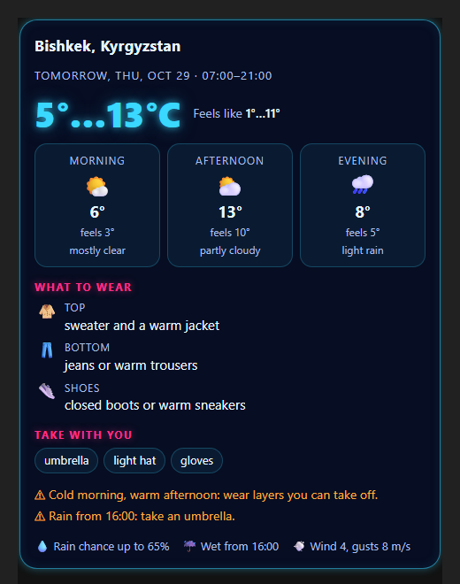

<p align="center">
  
</p>

<h1 align="center">Outfit Weather</h1>

<p align="center">
  A ChatGPT plugin that tells you <b>what to wear</b> today or tomorrow in any city,<br>
  from a whole-day forecast averaged over three weather models.
</p>

<p align="center">
  <a href="https://outfit-weather.onrender.com/">Website</a> ·
  <a href="https://outfit-weather.onrender.com/privacy">Privacy</a> ·
  <a href="https://outfit-weather.onrender.com/terms">Terms</a> ·
  <a href="https://outfit-weather.onrender.com/support">Support</a>
</p>

---



## What it does

Ask ChatGPT *"What should I wear tomorrow in Bishkek?"* and Outfit Weather:

- looks at the **whole day** from 07:00 to 21:00, not just one number,
- uses temperature, **feels-like**, rain, snow and wind,
- averages **three weather models** (ECMWF, ICON and GFS) from [Open-Meteo](https://open-meteo.com/),
- answers with a short text and a **neon card**: top, bottom, shoes, what to take, and warnings like "cold morning, warm afternoon" or "rain from 16:00".

Free, no account, no tracking.

## Try it in ChatGPT

1. In ChatGPT open **Settings → Plugins**, press **+**, then **Add custom MCP server**.
2. Connection: **Server URL** `https://outfit-weather.onrender.com/mcp`
3. Authentication: **No authentication**, then **Create**.
4. In a new chat turn on **Outfit Weather** and ask what to wear.

The server sleeps when nobody uses it, so the very first answer can take up to a minute.

<br clear="right">

## How it works

```
ChatGPT ──MCP──▶ Node.js server on Render ──▶ Cloudflare Worker ──▶ Open-Meteo
   ▲                     │  (geocoding + 3-model forecast)
   └── text + card ◀─────┘
```

- **MCP server** (`src/server.js`): one tool, `outfit_today(city, day)`, over stateless Streamable HTTP.
  It also serves the website and the icon.
- **Weather logic** (`src/weather.js`): pure functions (no network), so they are tested without the internet.
  Averages the models, picks the hours of the day, and turns them into outfit advice.
- **Card** (`src/widget/outfit-card.html`): one HTML file shown inside ChatGPT, using the open
  [MCP Apps](https://modelcontextprotocol.io/docs/extensions/apps) standard. It follows ChatGPT's light or dark theme.
- **Cloudflare Worker** (`worker/`): Render shares its internet address with many apps, which kept hitting
  Open-Meteo's daily limit. The Worker asks Open-Meteo from Cloudflare's network instead, protected by a secret key.
- **Cache** (`src/cache.js`): cities are remembered for a day, forecasts for 30 minutes
  (and up to 3 hours if Open-Meteo is unavailable).
- **Website** (`site/`): home page with a live example card, privacy policy, terms and support.
- **Plugin package** (`plugin/`): the manifest with the icon, links and review test cases for the ChatGPT directory.

## Run it yourself

Needs [Node.js](https://nodejs.org/) 24.

```bash
npm install
npm test          # weather logic and cache tests
npm start         # http://localhost:3000 (MCP endpoint: /mcp)
npm run inspect   # opens MCP Inspector to call the tool by hand
```

Optional environment variables:

| Name | What it does |
|---|---|
| `PORT` | Port to listen on (Render sets it) |
| `OPEN_METEO_PROXY_URL` | Cloudflare Worker address; empty string = call Open-Meteo directly |
| `OPEN_METEO_PROXY_KEY` | Secret key for the Worker |
| `SUPPORT_EMAIL` | Email shown on the website |

## Built with

Node.js · [MCP TypeScript SDK](https://github.com/modelcontextprotocol/typescript-sdk) · zod ·
[Open-Meteo](https://open-meteo.com/) · Render · Cloudflare Workers

## About

My third project on the way to becoming a developer. Earlier ones:
[Neon Armada](https://github.com/sivatorX/neon-armada) (Battleship game) and
[Neon Weather](https://github.com/sivatorX/neon-weather) (weather web app, whose forecast logic grew into this plugin).

Weather data by [Open-Meteo.com](https://open-meteo.com/) (CC BY 4.0).
